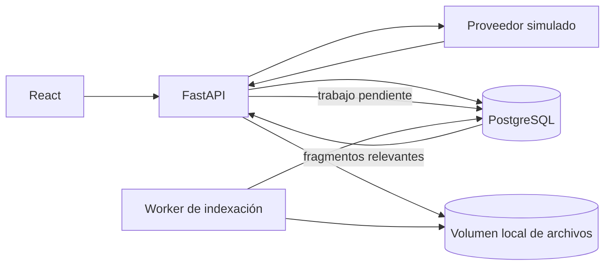

# Asistente RAG documental

Aplicación web React con API Python y PostgreSQL. Permite cargar `.txt`, `.md` y facturas PDF, revisar los campos sugeridos antes de habilitar un PDF, conversar con documentos aceptados y abrir sus citas. El modo de respuesta sigue siendo simulado y extractivo: no requiere clave ni envía documentos a un proveedor de modelos.

Para recorrer las responsabilidades actuales de cada componente y el flujo completo, consultá [la guía de la aplicación](docs/guia-de-la-app.md). Para entender las decisiones previstas de crecimiento —datos de facturas normalizados, preguntas convertidas en intenciones, SQL, búsqueda vectorial e híbrida— consultá [la guía de crecimiento](docs/crecimiento-rag-y-facturas.md).

## Ejecutar localmente

Requisitos: Docker Desktop con Compose. Desde PowerShell, en la raíz del proyecto:

```powershell
Copy-Item .env.example .env
docker compose up --build
```

Abrí [http://localhost:5173](http://localhost:5173). En el primer inicio Docker descarga PostgreSQL y Node, instala las dependencias web, corre la migración de base de datos y levanta la API, el worker de indexación y React. Los archivos pueden pesar hasta 15 MB; los PDF admiten hasta 50 páginas. Los escaneos usan OCR local en español e inglés.

Detené la aplicación con `Ctrl+C` y luego `docker compose down`. Los documentos, la base y las conversaciones persisten en volúmenes locales. `docker compose down -v` elimina esos volúmenes y sus datos. El archivo `.env` usa credenciales de desarrollo; cambiá la contraseña antes de compartir o desplegar la aplicación.

La consola educativa anterior sigue disponible:

```powershell
python -m rag_assistant ask --documents examples/documents "¿Qué código HTTP responde la API cuando se supera la cuota?"
python -m rag_assistant evaluate
```

## Arquitectura implementada



- **React + Vite:** interfaz de chat, historial, carga múltiple, lista de archivos, estado de indexación, eliminación y citas desplegables. Los PDF abren un flujo de revisión con vista previa, campos editables y evidencia por página. Vite reenvía `/api` a la API durante desarrollo.
- **FastAPI:** valida extensiones, UTF-8, tamaño y nombres; el worker limita y procesa las páginas PDF. La API expone documentos, revisión, conversaciones y mensajes; no accede a un proveedor externo.
- **PostgreSQL:** guarda espacios de trabajo, metadatos de documentos, estructura parseada, fragmentos, conversaciones, mensajes, citas y trabajos de indexación.
- **Worker aparte:** procesa documentos en segundo plano. Reclama trabajos con bloqueo `FOR UPDATE SKIP LOCKED`, marca estados y recupera trabajos que quedaron procesándose tras una caída. Se pueden ejecutar varios workers sin repartir un mismo trabajo.
- **Almacenamiento de originales:** el MVP escribe los archivos en un volumen local a través de `DocumentStorage`. La base conserva una clave interna, no una ruta enviada por el usuario.
- **Migraciones Alembic:** cambios del esquema quedan versionados en `migrations/` y se aplican al iniciar la API.

## PDFs de proveedores distintos

El extractor no elige una plantilla por nombre de proveedor. Busca conceptos habituales con alias en español e inglés —emisor, identificador fiscal, factura, fechas, moneda, impuestos, total, descripción y condiciones de pago— y conserva también etiquetas `campo: valor` desconocidas como campos editables. Esto permite recibir formatos nuevos sin crear una plantilla para cada empresa.

Para cada página se usa el texto y la ubicación de las palabras cuando el PDF los contiene. Si una página es un escaneo, se renderiza localmente y pasa por Tesseract. PDFium se usa para renderizar sin enviar el archivo a un servicio. El texto completo de las páginas queda dividido en fragmentos citables; así, las descripciones o renglones que no encajan en los campos comunes siguen disponibles para RAG.

Cada factura queda en `needs_review` después de extraer. La interfaz permite modificar o quitar candidatos, agregar campos propios del proveedor o servicio, consultar el PDF y confirmar. La confirmación guarda por separado los valores aceptados, la página y la evidencia original; esos valores se incorporan como fragmentos destacados y el documento pasa a `ready`. Los documentos pendientes no participan de la búsqueda.

La detección de campos es deliberadamente genérica: los alias no cubren todos los diseños ni reemplazan una revisión. Se conservan los valores como texto para no asumir formatos de fechas, moneda o números decimales; la normalización para consultas exactas y sumas por proveedor queda para una etapa siguiente. El OCR también puede leer mal caracteres, por eso el usuario confirma frente al archivo original.

## Decisiones de datos y sus consecuencias

| Decisión | Qué aporta | Qué cuesta o queda para después |
| --- | --- | --- |
| Guardar estructura y candidatos en `parsed_structure` JSONB | Conserva versión, páginas y campos sugeridos con su evidencia; permite cambiar parser y conceptos sin migrar una columna por cada proveedor. | JSONB es flexible, pero los montos aún no son valores decimales normalizados para sumas y reportes. |
| Guardar valores aceptados aparte en `approved_fields` | La respuesta usa campos revisados y preserva qué sugirió originalmente el extractor. Cada campo aceptado se puede recuperar y citar por página. | La aprobación humana lleva tiempo y no elimina el riesgo de que se confirme un error. Conviene agregar historial de revisiones si más personas revisan documentos. |
| Guardar cada página como fragmentos en `document_chunks` | Las citas de PDF señalan página; texto de servicios no previsto por el esquema sigue siendo buscable. | Tablas de renglones y consultas aritméticas entre documentos requieren normalizar datos en un paso separado. |
| Parsear sin plantilla fija por proveedor | Los alias comunes y los campos `etiqueta: valor` soportan facturas nuevas y campos propios. | Las reglas simples no resuelven todos los diseños de tabla. La extracción más avanzada debe medirse con ejemplos representativos y siempre conservar la aprobación. |
| PostgreSQL Full Text Search con índice GIN | Recupera coincidencias sin cargar toda la colección en memoria; normaliza acentos y admite prefijos sencillos. No requiere un modelo de embeddings. | Es búsqueda léxica: no entiende bien paráfrasis o sinónimos. El nombre `tsvector` corresponde al índice de texto completo de PostgreSQL, no a embeddings semánticos. La etapa semántica puede añadir `pgvector` y compararse con el conjunto de evaluación. |
| Cola de indexación en PostgreSQL | Trabajos durables y workers escalables sin agregar Redis en el MVP. Los estados son `queued`, `processing`, `needs_review`, `ready` y `failed`. | La base cumple dos funciones. Si la carga de trabajos crece mucho, se puede mover la cola a un broker dedicado sin cambiar el modelo de documentos. |
| Archivos originales en un volumen local | Desarrollo privado, persistente y sencillo; las cargas no salen de la máquina. | Varias instancias en distintos hosts necesitan un almacenamiento compartido. `DocumentStorage` es la frontera para cambiar a S3 o un servicio compatible cuando se despliegue. |
| Espacios de trabajo en el esquema | Documentos y conversaciones ya están agrupados bajo un `workspace_id`. | La UI actual crea un espacio local único y no tiene usuarios ni autenticación. Para uso compartido hay que agregar identidad, permisos y aislamiento por espacio antes de publicar. |
| Conversaciones y citas persistidas en PostgreSQL | El historial sobrevive reinicios y las citas guardan nombre, página o líneas y extracto aunque después se quite el archivo. | El crecimiento del historial requiere una política de retención o borrado por conversación. |

La política de retención es explícita: quitar un archivo borra su registro, su estructura parseada y sus fragmentos; mensajes previos conservan la cita y el extracto como evidencia histórica.

## Flujo de una pregunta

1. React envía el mensaje a FastAPI; el servidor lo guarda en la conversación.
2. PostgreSQL busca entre los fragmentos `ready` del espacio actual con su índice GIN y devuelve los mejores candidatos.
3. El proveedor simulado aplica el umbral de evidencia, cita una oración textual o se abstiene.
4. La API guarda respuesta, citas y candidatos en el historial; React muestra la fuente y permite desplegar su extracto.

El simulador no sintetiza hechos. Una respuesta respaldada reproduce una oración del fragmento. La regla de abstención es una línea de base educativa, no una garantía de razonamiento semántico.

## Crecimiento previsto

En una sola máquina podés aumentar recursos de PostgreSQL y levantar más workers con `docker compose up --scale worker=3`. Para crecer entre hosts, los originales deben pasar a un almacenamiento compartido y la API debe recibir autenticación, secretos administrados, copias de seguridad, cuotas y monitoreo. Antes de publicar documentos privados, también hay que definir quién puede acceder a cada espacio.

El próximo salto para facturas sería normalizar fecha, moneda e importes aprobados en tablas para habilitar filtros y agregaciones SQL, manteniendo la evidencia original. Después se puede comparar recuperación léxica con embeddings y `pgvector`. Para combinar caminos, un enrutador puede enviar cálculos a consultas SQL validadas, consultas exactas a filtros estructurados y preguntas conceptuales a búsqueda vectorial o híbrida. No conviene ejecutar SQL arbitrario generado por un modelo. No integré un proveedor real.

## Estructura principal

- `frontend/`: aplicación React y proxy de desarrollo.
- `rag_assistant/web/app.py`: endpoints HTTP para archivos y chat.
- `rag_assistant/web/worker.py`: cola e indexación de documentos.
- `rag_assistant/pdf_ingestion.py`: extracción local de PDF, OCR y sugerencias genéricas de campos.
- `rag_assistant/db_models.py`: tablas y restricciones SQLAlchemy.
- `migrations/versions/0001_initial.py`: esquema inicial e índices.
- `migrations/versions/0002_pdf_invoice_review.py`: páginas citables y etapa de revisión humana.
- `rag_assistant/db_retrieval.py`: búsqueda PostgreSQL y conversión a evidencia para el proveedor.
- `rag_assistant/storage.py`: contrato y adaptador de archivos locales.
- `rag_assistant/providers/`: interfaz de proveedor y simulador.
